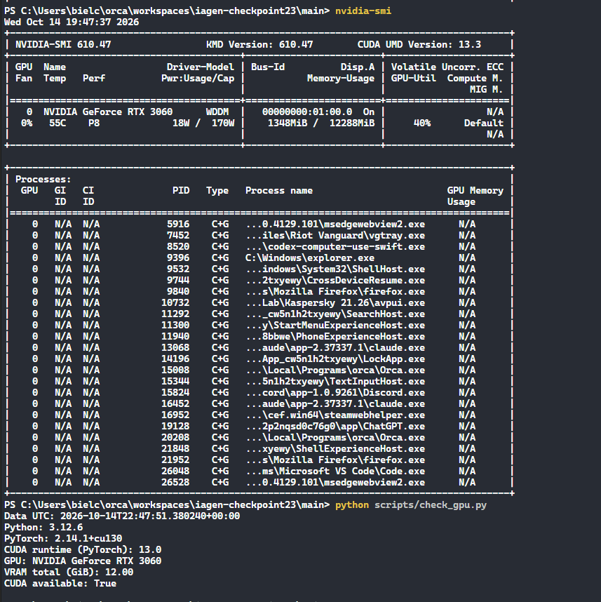

# Roteiro sugerido para apresentação

1. **Problema:** direcionar chamados para a equipe certa; mostrar as cinco categorias e um exemplo de entrada/saída.
2. **Modelo:** Qwen2.5-0.5B-Instruct e por que LoRA permite fine-tuning em uma GPU doméstica de 12 GB.
3. **Dados:** mostrar contagem e partições em `data/`; explicar que são sintéticos e que não suportam alegações de uso real.
4. **Método:** prompt de classificação, loss sobre o rótulo gerado, CUDA obrigatória, semente, rank LoRA e matriz de quatro combinações de taxa de aprendizado/épocas.
5. **Hardware:** abrir o terminal integrado do VS Code e executar `nvidia-smi` seguido de `python scripts/check_gpu.py`; capturar a tela inteira com GPU, memória e CUDA disponível visíveis. Na máquina de desenvolvimento, o `nvidia-smi` observou NVIDIA GeForce RTX 3060 com 12 GB em 14/10/2026; repita a verificação no equipamento usado na apresentação.
6. **Resultados:** preencher a tabela abaixo diretamente dos CSV/JSON gerados; comentar macro-F1 e matriz de confusão, incluindo número reduzido de exemplos.
7. **Demonstração:** `streamlit run app.py`, inserir chamado de cada categoria e mostrar a previsão e GPU ativa.
8. **Limitações e próximos passos:** aumentar e revisar dataset, avaliar em mensagens reais anonimizadas sob autorização, fazer divisão mais robusta, comparar base sem ajuste, calibrar/revisar previsões incertas e medir latência.

## Tabela de resultados

| Configuração | LR | Épocas | Loss validação | Accuracy validação | Macro-F1 validação |
|---|---:|---:|---:|---:|---:|
| lr1e-4_ep2 | 0,0001 | 2 | 3,732 | 0,50 | 0,381 |
| lr1e-4_ep3 | 0,0001 | 3 | 1,777 | 0,50 | 0,381 |
| lr2e-4_ep2 | 0,0002 | 2 | 0,765 | 0,90 | 0,893 |
| lr2e-4_ep3 | 0,0002 | 3 | 0,158 | 0,90 | 0,893 |

Execução observada em NVIDIA GeForce RTX 3060 (12 GB), CUDA 13.0, PyTorch 2.14.1. Configuração selecionada por menor loss entre as configurações empatadas em macro-F1: lr `2e-4`, 3 épocas. No teste: accuracy `0,90`, macro-F1 `0,893` (9/10 exemplos corretos). Um exemplo de `outros` foi previsto como `acesso`. Consulte a matriz e as previsões completas em `results/test_metrics.json` e `results/test_predictions.csv`. Os arquivos de resultados descrevem esta execução local; artefatos do adaptador não são versionados.

## Evidência da GPU

Captura do terminal PowerShell com `nvidia-smi` e `check_gpu.py`:

